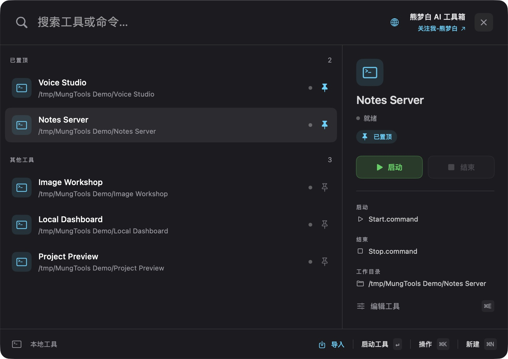
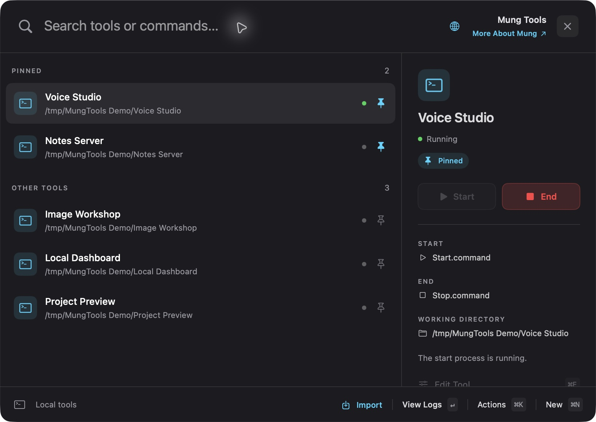
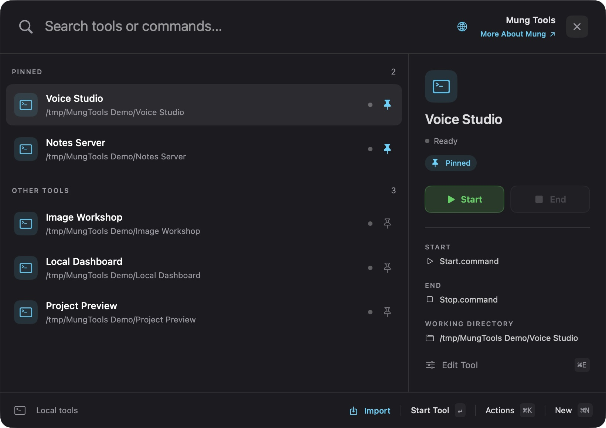
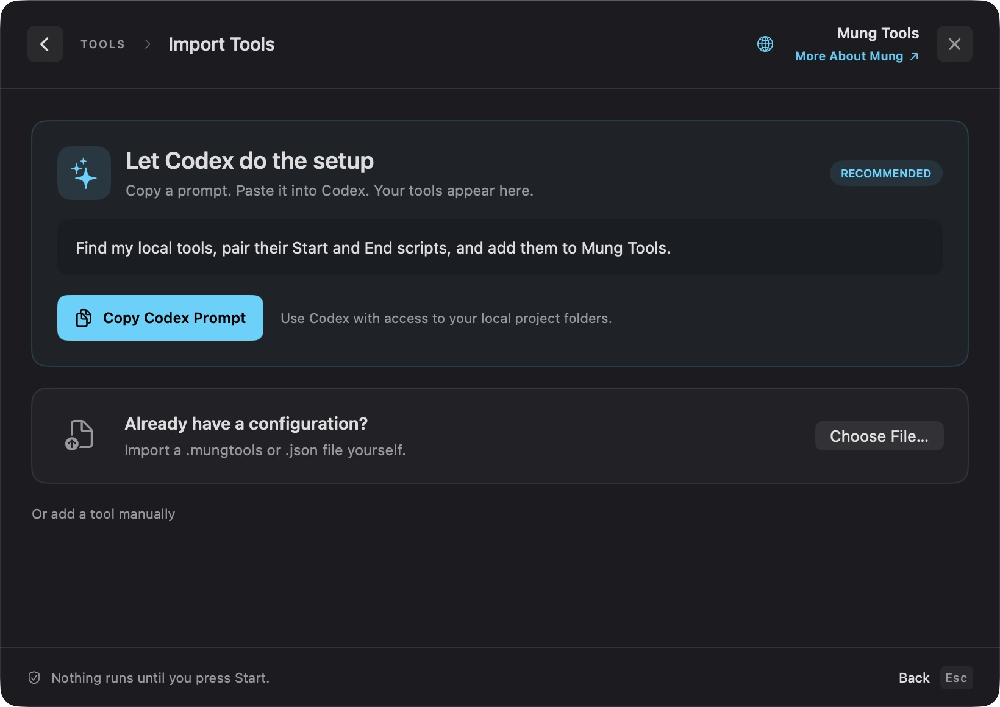

[下载我这个工具](https://github.com/MungbPro/MungTools/releases/latest/download/MungTools-macOS-arm64.zip)

# 熊梦白 AI 工具箱

**把你的本地工具，放进一个小小的菜单栏。**

[English](README.md) · [关注我-熊梦白 · @mungbpro](https://x.com/mungbpro)



**macOS 14+ · Apple 芯片 Mac · 英文 / 简体中文 · 免费开源**

你的文件夹里也有一堆 `Start.command`、`Stop.command` 吗？给每个工具起个名字，配好脚本，就能在这里统一启动和结束。可以让 Codex 帮你查找、配对，也可以自己添加。

## 启动、结束，一眼就懂

- **绿色启动，红色结束。** 未启动时，结束按钮为灰色；启动后，启动按钮变灰。
- **常用工具置顶。** 喜欢的放上面，其他的直接搜索。
- **留在菜单栏。** 点击 **×** 隐藏窗口，工具继续运行。点击菜单栏图标即可回来。
- **用你自己的命令。** 导入配置、选择可执行脚本，或填写 Shell 命令；也可以加网址、看日志。
- **中英文切换。** 点击地球按钮，选择 English 或简体中文。

<table>
  <tr>
    <td width="50%"></td>
    <td width="50%"></td>
  </tr>
  <tr>
    <td align="center">清楚的启动和结束状态</td>
    <td align="center">内置英文和简体中文</td>
  </tr>
</table>

[下载我这个工具](https://github.com/MungbPro/MungTools/releases/latest/download/MungTools-macOS-arm64.zip)

## 让 Codex 帮你导入工具

1. 解压下载的文件，将 **Mung Tools.app** 放入**应用程序**，然后打开。
2. 点击**导入 → 复制 Codex 提示词**，粘贴到 Mac 上的 Codex，并告诉它可以查看哪些文件夹。
3. 核对 Codex 配对的工具。它会生成并打开导入文件，工具就出现在工具箱里了。需要时再点击**启动**。



Codex 需要访问你选定的文件夹。此流程使用你已有的 Codex，工具箱无需 API Key 或连接账户。导入配置不会执行其中的命令。文件格式和查找规则见 [Codex 导入说明](docs/CODEX-IMPORT.md)。

**手动添加：**点击**新建**自己选择脚本，或通过**导入 → 选择文件**导入已有配置。详见[使用说明](docs/USAGE.zh-CN.md)。

下载版工具箱无需 Python、Node.js 或 Xcode；你启动的工具可能有自己的运行要求。此版本使用临时签名，尚未经 Apple 公证；如果 macOS 阻止打开，请参阅 [Apple 官方说明](https://support.apple.com/en-us/102445)。

**几个顺手的快捷键：** `⌘F` 搜索 · `⌘P` 置顶 · `⌘K` 操作 · `⌘N` 新建 · `⌘H` 隐藏窗口。

所有图片均使用虚构的演示工具，不包含个人项目、脚本或配置。

## 使用前知道这几点

工具箱执行你配置的命令，不会自行扫描文件夹，也不会检查外部服务是否健康运行。如果启动命令会另外打开应用或后台服务，请配置相应的结束命令。重新打开工具箱后，需要先在这里启动工具，结束按钮才会再次可用。

配置与日志保存在本机。命令设置、结束行为、快捷键和数据位置，见[使用说明](docs/USAGE.zh-CN.md)。

## 自己构建

需要包含 Swift 的 Apple 命令行工具、Apple 芯片 Mac，以及 macOS 14 或更新版本。

```sh
git clone https://github.com/MungbPro/MungTools.git
cd MungTools
./install.sh
```

也可以下载[源码 ZIP](https://github.com/MungbPro/MungTools/archive/refs/heads/main.zip)，解压后在文件夹内运行 `./install.sh`。测试与打包方法见[开发说明](docs/USAGE.zh-CN.md#开发)。

## 作者：熊梦白 / Mung

有想法或发现问题？欢迎[提交 Issue](https://github.com/MungbPro/MungTools/issues)。

[关注我-熊梦白 · X：@mungbpro](https://x.com/mungbpro) · [MIT 许可证](LICENSE)

[下载我这个工具](https://github.com/MungbPro/MungTools/releases/latest/download/MungTools-macOS-arm64.zip)
