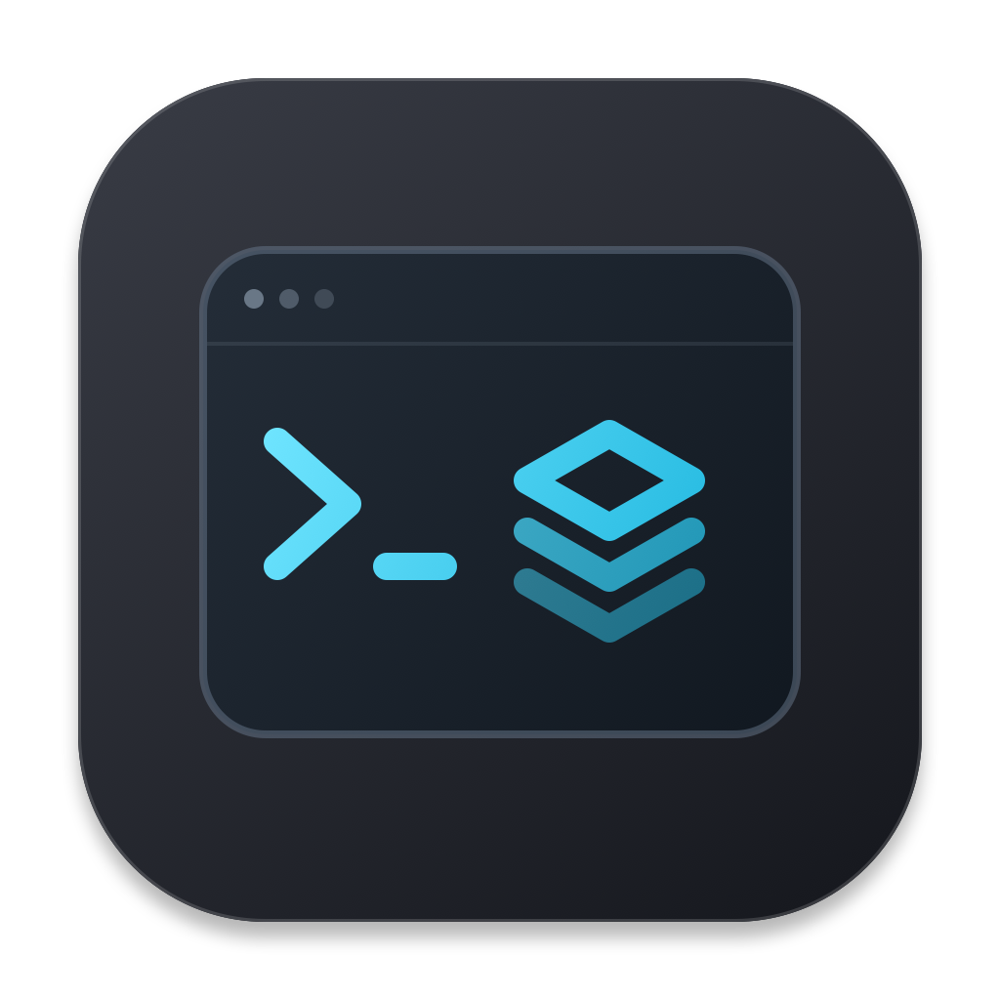

# Install Mung Tools

[简体中文](DOWNLOAD.zh-CN.md) · [Back to Mung Tools](../README.md) · [Mung on X](https://x.com/mungbpro)



## Run one command

On an **Apple Silicon Mac with macOS 14 or later**, paste this into **Terminal**:

```sh
/bin/bash -o pipefail -c 'curl -fsSL https://raw.githubusercontent.com/MungbPro/MungTools/main/install-from-source.sh | /bin/bash'
```

[Review the installer before running it](../install-from-source.sh).

The script downloads a checksum-pinned source archive from this project’s GitHub release, compiles the app on your Mac, and installs it in `~/Applications/Mung Tools.app`. It then opens the app; click its menu-bar icon to see your tools.

**First time?** Apple’s Command Line Tools with Swift are required. If they are missing, the script opens Apple’s official installer and stops. Finish that installation, then run the same command again. Full Xcode, Python, Node.js, and an API key are not required.

Your saved configuration and running tools stay in place. The installer does not execute your tool scripts or quit a running launcher. If Mung Tools is already open, its current session keeps running and the update takes effect at the next launch.

## Prefer Codex?

Paste this into Codex on your Mac:

```text
Install Mung Tools from https://github.com/MungbPro/MungTools on this Mac. Read its installation guide and install-from-source.sh, then use the source installer. Preserve my existing configuration and running tools. Do not execute my tool scripts, quit a running launcher, or disable macOS security. If Apple Command Line Tools are missing, help me install them and continue afterward.
```

## Download source instead

[Download the source ZIP](https://github.com/MungbPro/MungTools/archive/refs/heads/main.zip), unzip it, and run `./install.sh` from that folder after installing Apple’s Command Line Tools. See [build details](USAGE.md#development).

## Why source installation?

The earlier prebuilt app downloads are **not Apple-notarized** and macOS can block them. The installation route above builds an app locally from published source. It does not remove quarantine metadata or disable Gatekeeper, and it is not an Apple malware scan or notarization approval.

A normal direct app download needs Developer ID signing and Apple notarization. That distribution option is not ready yet; changing the icon or packaging the same app in a DMG cannot provide it. See [Apple’s Developer ID guide](https://developer.apple.com/developer-id/).

## If macOS shows a warning

| The alert says… | What to do |
| --- | --- |
| Apple cannot verify the developer or check for malware | The current release lacks the required distribution verification. Use the source build above or wait for a notarized release. This warning does not establish that the app is safe. |
| The app will damage your computer or contains malware | Do not open it. Remove that copy and report the exact message in an issue. |
| The app is damaged or has been modified | Do not override the warning. Remove that copy and report it; a corrupt or altered download needs investigation. |

See [Apple’s explanation of these alerts](https://support.apple.com/en-us/102445). This project does not recommend disabling Gatekeeper or removing quarantine metadata to install the app.

## Add your first tools

Click **Import → Copy Codex Prompt**, paste into Codex with access to the folders you choose, and review its script pairs. Or click **New** to add a tool manually. Importing never starts a tool; click **Start** when ready.

Need help? [Open an issue](https://github.com/MungbPro/MungTools/issues) with your macOS version and the alert text. Do not include private project files or credentials.

[More About Mung · @mungbpro on X](https://x.com/mungbpro)
